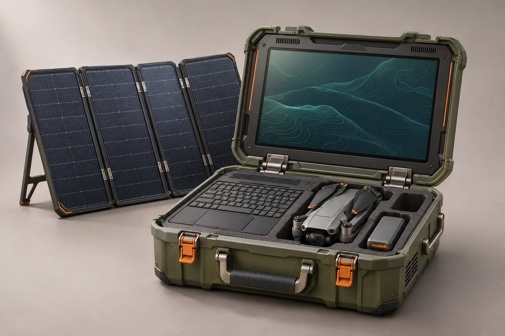
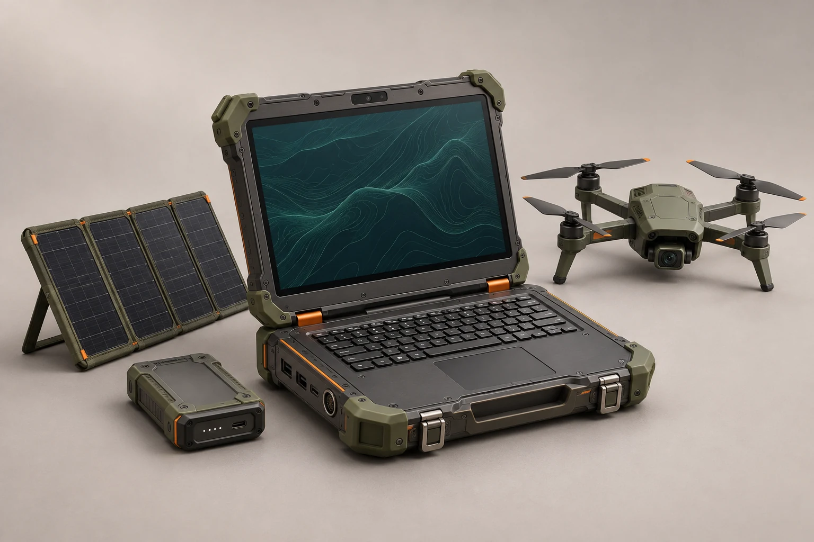
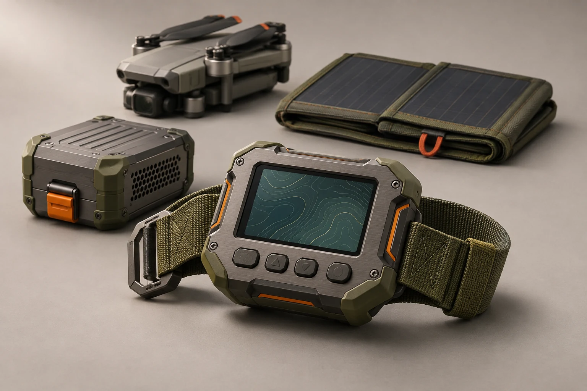
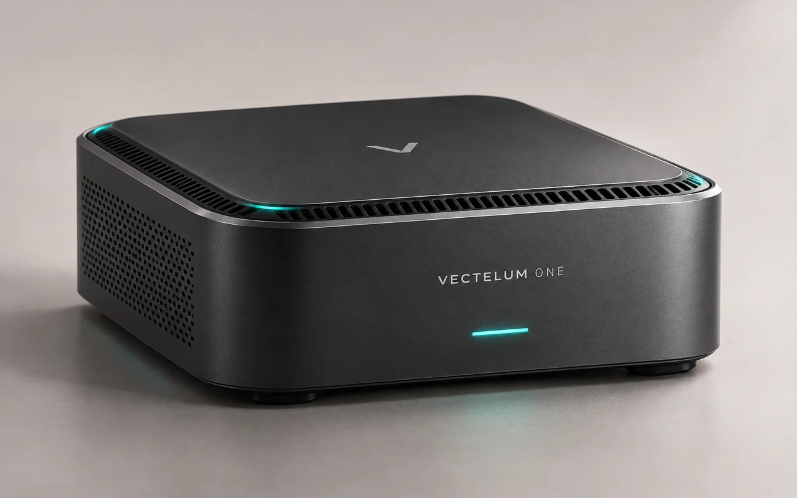
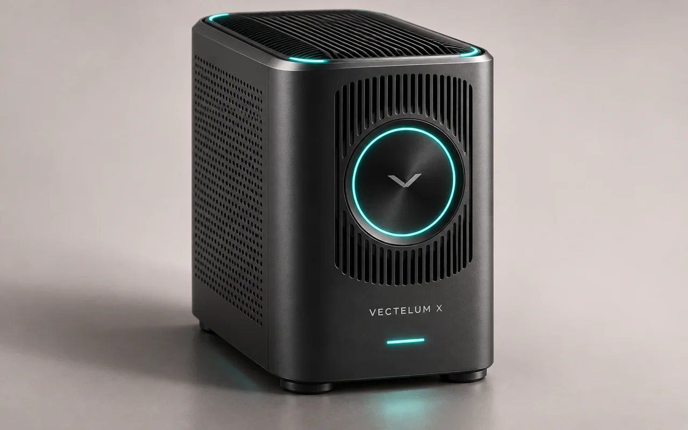
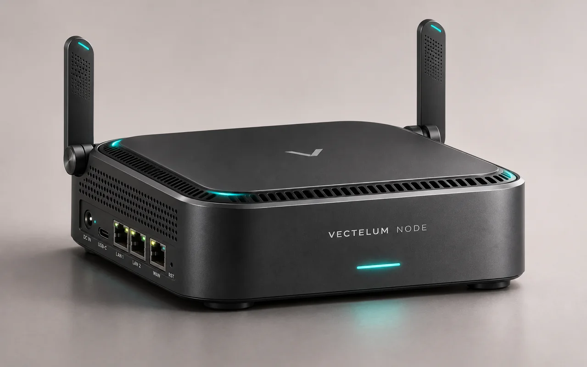
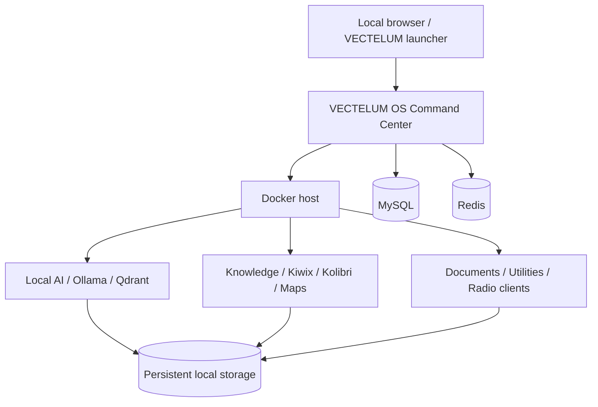

<div align="center">
  
  
  # VECTELUM OS
  ### Intelligence is yours.
  
  Local AI · Offline knowledge · Personal computing · Independent networks
  
  [](LICENSE)
  [](VECTELUM.md)
  [](#device-requirements)
  [](https://github.com/cyberzone51/vectelum-os/issues)
</div>

---

VECTELUM OS is an open-source, browser-based management platform for local AI, prepared offline knowledge, maps, documents, applications and device services. It is the software foundation of the proposed **VECTELUM NETWORK** hardware ecosystem: personal AI computers, portable field stations and independent local network devices.

It is an independent derivative of [Project NOMAD](https://github.com/Crosstalk-Solutions/project-nomad) by Crosstalk Solutions and contributors, not a new operating-system kernel or a complete Linux distribution.

## Contents

- [Project status](#project-status)
- [VECTELUM NETWORK](#vectelum-network)
- [How it works](#how-it-works)
- [What's included](#whats-included)
- [Installation & quickstart](#installation--quickstart)
- [Device requirements](#device-requirements)
- [AI models and remote compute](#ai-models-and-remote-compute)
- [Offline usage and privacy](#offline-usage-and-privacy)
- [Security](#security)
- [Development and maintenance](#development-and-maintenance)
- [Roadmap](#roadmap)
- [Resources and contributing](#resources-and-contributing)
- [License and attribution](#license-and-attribution)

## Project status

**Developer preview — 14 November 2026**

| Component | Status |
|---|---|
| VECTELUM branding, Command Center and launcher | Implemented in this fork |
| Local Docker build | Built and launched successfully on Ubuntu 24.04 under WSL2 |
| Tested image | `vectelum-os:56350b3` |
| Build version | `1.35.1-vectelum.1` |
| Management API | HTTP 200 at `/api/health` in the local test deployment |
| Database and Redis | Healthy in the local test deployment |
| 22 launcher entries | Available as shortcuts; individual app workflows require configuration and testing |
| Independent installer, image registry and update channel | Not yet released |
| Six hardware designs | Concepts only; no validated custom hardware |
| Cross-device networking and security hardening | Planned; not validated |

The verified deployment used existing upstream-compatible MySQL, Redis, data directories and application containers, and replaced the management container with the locally built VECTELUM image. This is a software prototype, not evidence of manufacturing readiness, audited security or validated field performance.

## VECTELUM NETWORK

One proposed local-first platform, six device concepts.

<table>
  <tr>
    <td width="50%" valign="top">
      
      <h3>BASECAMP</h3>
      <p>Portable field station with prepared maps, documents and optional AI</p>
      <p><sub>First planned product; optional solar and drone kit</sub></p>
    </td>
    <td width="50%" valign="top">
      
      <h3>RANGER</h3>
      <p>Compact expedition computer for research, navigation and field notes</p>
      <p><sub>Exploratory; solar panel and drone are optional, not included</sub></p>
    </td>
  </tr>
  <tr>
    <td width="50%" valign="top">
      
      <h3>SCOUT</h3>
      <p>Wearable interface to a separate local compute host</p>
      <p><sub>Exploratory; drone not included</sub></p>
    </td>
    <td width="50%" valign="top">
      
      <h3>ONE</h3>
      <p>Personal home AI server and household knowledge hub</p>
      <p><sub>Future concept</sub></p>
    </td>
  </tr>
  <tr>
    <td width="50%" valign="top">
      
      <h3>X</h3>
      <p>Personal AI workstation for local models, documents and creative work</p>
      <p><sub>Future concept</sub></p>
    </td>
    <td width="50%" valign="top">
      
      <h3>NODE</h3>
      <p>Local network appliance for service discovery and device coordination</p>
      <p><sub>Future concept; optional compatible radio links</sub></p>
    </td>
  </tr>
</table>

*AI-generated concept visualizations from the VECTELUM NETWORK landing page, not photographs of functional hardware.*

The proposed product architecture has four layers:

| Layer | Role |
|---|---|
| **VECTELUM CORE** | Local language models, document retrieval and assistant workflows |
| **VECTELUM OS** | Browser-based setup, application management and device controls |
| **VECTELUM VAULT** | Prepared knowledge, maps, documents, storage and backup workflows |
| **VECTELUM MESH** | Proposed local discovery, sharing and coordination across devices |

These names describe the intended ecosystem. CORE, VAULT and MESH are not independently released products, and their cross-device integrations have not been validated. The existing OS prototype inherits many relevant capabilities from upstream.

## How it works

The Command Center is a web UI and API that manages Docker-hosted services. Applications and content run on the device or on a configured local host. Users access the tools through a browser, including from another trusted local device when properly configured.



The current implementation uses Node.js, TypeScript, AdonisJS, React, Inertia, Vite, MySQL, Redis and Docker. The management container uses the host Docker socket to orchestrate other containers. Legacy NOMAD service names and paths remain for compatibility.

Key inherited capabilities include:

- Local AI conversation and semantic document retrieval (RAG), with Ollama and Qdrant or a compatible configured model endpoint.
- Downloadable offline reference libraries, educational material and regional maps.
- Local notes, data processing and a catalog of installable container applications.
- Guided setup, content selection, ZIM archive management and system benchmarking.
- App and content management. Upstream core auto-updates exist in the source but must remain disabled for the branded deployment until an independent update path is implemented.

## What's included

The launcher exposes the following 22 entries. Most are upstream or third-party tools, not original VECTELUM inventions. Apps, models, map regions and reference datasets may require separate installation or downloads before use.

| # | Capability | Powered by | Function |
|---|---|---|---|
| 1 | Information Library | [Kiwix](https://kiwix.org/) | Read prepared Wikipedia, reference collections and ebooks offline |
| 2 | Education Platform | [Kolibri](https://learningequality.org/kolibri/) | Offline educational channels, lessons and progress tracking |
| 3 | AI Assistant | [Ollama](https://ollama.com/) + [Qdrant](https://qdrant.tech/) | Local models, chat and document retrieval |
| 4 | Offline Maps | [Protomaps](https://protomaps.com/) | Download selected regions for local map viewing |
| 5 | Drug Reference | Prepared FDA label data | Search reference information; not a diagnostic or treatment tool |
| 6 | Translated Library | Bergamot | Local translation for supported content and downloaded language models |
| 7 | Notes | [FlatNotes](https://github.com/dullage/flatnotes) | Local markdown notes |
| 8 | Stirling PDF | [Stirling PDF](https://github.com/Stirling-Tools/Stirling-PDF) | Local PDF processing |
| 9 | File Browser | [File Browser](https://github.com/filebrowser/filebrowser) | Local file browsing and management |
| 10 | Calibre Web | [Calibre-Web](https://github.com/janeczku/calibre-web) | Browse a prepared ebook library |
| 11 | Excalidraw | [Excalidraw](https://github.com/excalidraw/excalidraw) | Sketch diagrams and plans |
| 12 | Jellyfin | [Jellyfin](https://jellyfin.org/) | Local media library and playback |
| 13 | Data Tools | [CyberChef](https://gchq.github.io/CyberChef/) | Encoding, hashing and data transformation |
| 14 | IT Tools | [IT-Tools](https://github.com/CorentinTh/it-tools) | Developer and technical utilities |
| 15 | Homebox | [Homebox](https://github.com/sysadminsmedia/homebox) | Inventory and equipment management |
| 16 | Vaultwarden | [Vaultwarden](https://github.com/dani-garcia/vaultwarden) | Self-hosted credential management; secure configuration required |
| 17 | Meshtastic Web | [Meshtastic](https://meshtastic.org/) | Configure compatible mesh radio devices |
| 18 | MeshCore Web | [MeshCore](https://github.com/meshcore-dev/MeshCore) | Interface for compatible radio equipment |
| 19 | Easy Setup | Inherited setup wizard | Select applications and prepared content |
| 20 | Supply Depot | Inherited app catalog | Install supported or custom Docker applications |
| 21 | Docs | Local documentation | Setup, operating and troubleshooting guidance |
| 22 | Settings | Command Center | Manage local configuration and services |

Additional inherited utilities include hardware benchmarking, offline content selection, ZIM management and system diagnostics. The upstream benchmark service is operated separately by Project NOMAD.

## Installation & quickstart

### Before you start

VECTELUM OS currently targets Debian-based Linux on x86-64 with Docker Engine and Docker Compose v2. The developer preview was built and run on Ubuntu 24.04 LTS under Windows WSL2 using native Docker inside Ubuntu. Build dependencies and initial content require internet access and additional disk space.

**There is no standalone VECTELUM installer or published production image yet.** The legacy NOMAD installer in this repository still installs upstream components. It is not a VECTELUM one-command installer.

### Build the tested image from our repository

Run in a Linux terminal with access to the Docker daemon:

```bash
git clone https://github.com/cyberzone51/vectelum-os.git
cd vectelum-os
git checkout 56350b3
docker build \
  --build-arg VERSION=1.35.1-vectelum.1 \
  --build-arg VCS_REF=56350b3 \
  -t vectelum-os:56350b3 .
git checkout main
```

Use an up-to-date Docker installation. The multi-stage build downloads Node packages and map tooling; allow substantial free space for intermediate layers. Build duration depends on hardware and network speed. The version above identifies the tested source revision rather than a published release.

### Switch an existing compatible local installation

This is the tested approach. Back up the original Compose file, MySQL, Redis and application storage before any change. The application entrypoint runs migrations and database seeding. Review version compatibility and verify the backups before proceeding.

From the repository root, on a host with the existing installation at `/opt/project-nomad`:

```bash
export VECTELUM_REPO="$(pwd)"
export VECTELUM_IMAGE=vectelum-os:56350b3

docker compose --project-directory /opt/project-nomad \
  -f /opt/project-nomad/docker-compose.yml \
  -f "$VECTELUM_REPO/install/vectelum-compose.override.yaml" \
  config --images

# Stop the upstream updater so it cannot replace the branded image.
docker compose --project-directory /opt/project-nomad \
  -f /opt/project-nomad/docker-compose.yml stop updater

# Recreate only the management container; preserve existing data and apps.
docker compose --project-directory /opt/project-nomad \
  -f /opt/project-nomad/docker-compose.yml \
  -f "$VECTELUM_REPO/install/vectelum-compose.override.yaml" \
  up -d --no-deps --pull never admin

docker inspect --format '{{.Config.Image}} {{.State.Health.Status}}' nomad_admin
curl -f http://127.0.0.1:8080/api/health
```

Check that the existing port mapping restricts management access to loopback, e.g. `127.0.0.1:8080:8080`. The override preserves existing ports and mounts; it does not secure an already exposed deployment.

Open **http://127.0.0.1:8080/home** when healthy. The launcher is available in [vectelum-launcher/](vectelum-launcher/); serve its static files locally and configure the appropriate local service addresses. A GitHub source page does not itself run the backend.

### Advanced installation

For experienced Docker users, [install/management_compose.yaml](install/management_compose.yaml) is the inherited template. Configure all placeholders (including unique credentials and APP_KEY), loopback-only management/log ports, persistent data paths and required host dependencies before use. Combine it with [install/vectelum-compose.override.yaml](install/vectelum-compose.override.yaml) to select the local VECTELUM image. The template alone uses upstream images. A fresh deployment using this combination has not yet been validated end-to-end.

Upstream installation references (for the original foundation, not a branded distribution): [Linux installation](https://www.projectnomad.us/install), [WSL2 installation](https://www.projectnomad.us/install/wsl2), [upstream README](UPSTREAM-README.md).

## Device requirements

These are **upstream sizing guidelines**, not measured specifications or guarantees for VECTELUM devices. Actual requirements depend on selected applications, content and models.

| Component | Basic management / offline tools | Recommended for local AI |
|---|---|---|
| CPU | Dual-core 2 GHz or better | Ryzen 7 / Core i7 class or better |
| RAM | 4 GB system memory | 32 GB system memory |
| GPU | Optional for basic tools | RTX 3060 class or compatible equivalent; model support varies |
| Storage | 5 GB upstream base minimum; 10 GB for comfortable basic install | 250 GB SSD or more, depending on models and content |
| Operating system | Debian-based Linux x86-64 | Debian-based Linux x86-64 |
| Connectivity | Required for initial installation/downloads | Required for initial model and resource downloads |

Upstream also documents an approximate 25 GB footprint for a general-purpose AI installation. Building the image from source requires extra temporary storage beyond runtime requirements. A discrete GPU is optional for many small models; CPU inference can be slow. Model memory usage and GPU support must be checked separately. ARM, macOS and other distributions have not been validated for this fork.

See the [upstream hardware guide](https://www.projectnomad.us/hardware) and [FAQ](FAQ.md) for further sizing guidance.

## AI models and remote compute

The inherited AI Assistant can use a local Ollama installation or a configured Ollama/OpenAI-compatible endpoint such as LM Studio or llama.cpp. Models must be downloaded on the machine that runs them. Ollama provides model-management functions not available through every compatible endpoint.

For another local host, configure the endpoint in AI settings and restrict its network access to trusted clients. Do not expose an unauthenticated model server publicly. If a remote or cloud API is used, that workflow is no longer fully offline or necessarily local-private.

AI output and retrieved information can be incorrect. Model performance, source accuracy, available memory, response speed and document indexing need to be validated for each deployment.

## Offline usage and privacy

Prepared content and locally installed models can be used without internet access when their dependencies are available. Initial setup, additional downloads, updates, certain integrations and external APIs require connectivity.

Upstream documents no built-in telemetry in its core and uses connectivity checks against Cloudflare, GitHub and the Project NOMAD API. The inherited connectivity URL can be configured under **Settings → Advanced** or via `INTERNET_STATUS_TEST_URL` (environment setting takes precedence). This fork has not completed an independent network-traffic or privacy audit. Third-party apps can have their own network behavior.

Local-first is a design objective, not a guarantee that all workloads are private or disconnected. Prepare necessary content in advance, inspect app configurations and test the intended workflow with the internet disconnected.

## Security

> [!WARNING]
> The inherited management interface does not provide built-in authentication. It has access to the host Docker socket. **Do not expose the Command Center or its management services directly to the public internet.**

Use loopback binding, appropriate firewall/network controls and a trusted local environment. Restrict access to model endpoints and logging services. Secure third-party services according to their own documentation; use unique credentials, appropriate transport security and tested backups. Do not publish environment files, credentials, database dumps or private logs.

Dependency audits during the development build reported unresolved vulnerabilities. This preview is not security-certified or production-ready. An authentication/access-control design, dependency review and deployment threat model are required before commercial or multi-user use.

## Development and maintenance

| Path | Description |
|---|---|
| [admin/](admin/) | Command Center source and application UI |
| [admin/docs/](admin/docs/) | Inherited and adapted local documentation |
| [install/](install/) | Inherited installation assets and VECTELUM Compose override |
| [vectelum-launcher/](vectelum-launcher/) | Standalone local application launcher |
| [Dockerfile](Dockerfile) | Multi-stage application image build |
| [VECTELUM.md](VECTELUM.md) | Developer-preview status and runtime notes |
| [UPSTREAM-README.md](UPSTREAM-README.md) | Original upstream documentation |

### Check and restart the branded backend

Use the same base and override for maintenance. From the repository root:

```bash
docker compose --project-directory /opt/project-nomad \
  -f /opt/project-nomad/docker-compose.yml \
  -f "$PWD/install/vectelum-compose.override.yaml" ps

docker logs --tail 100 nomad_admin

docker compose --project-directory /opt/project-nomad \
  -f /opt/project-nomad/docker-compose.yml \
  -f "$PWD/install/vectelum-compose.override.yaml" restart admin
```

Keep the tested image tag available. Do not run the legacy upstream update script or enable core auto-updates on a branded deployment: they may replace the VECTELUM image. The inherited dry-run update command (`node ace auto-update:dry-run --scenarios`, from `admin/` with dependencies installed) is a development-only simulation, not an independent update channel.

For rollback, use the backed-up original configuration and original image; first evaluate database migration compatibility and whether backup restoration is required. Avoid destructive volume removal, storage moves or uninstall operations without verified backups. The upstream helper scripts are documented in [UPSTREAM-README.md](UPSTREAM-README.md#helper-scripts); they are not branded maintenance commands.

## Roadmap

- **Software prototype:** complete functional testing of the branded backend and offline workflows.
- **Independent distribution:** create reviewed installer, image metadata, releases, secure updates and recovery documentation.
- **Platform hardening:** evaluate authentication, access controls, dependency vulnerabilities, backup and restore.
- **BASECAMP:** validate an x86-64 bench unit, field workflows, local AI, power and cooling; evaluate accessories separately.
- **Hardware family:** evaluate RANGER, SCOUT, ONE, X and NODE using customer evidence and measured prototype results.
- **Network:** test discovery, sharing and synchronization with explicit security boundaries and compatible hardware.

The roadmap is a development plan, not a commitment that all six devices are available.

## Resources and contributing

- [VECTELUM OS repository](https://github.com/cyberzone51/vectelum-os)
- [Report bugs or request features](https://github.com/cyberzone51/vectelum-os/issues)
- [Contribution guidelines](CONTRIBUTING.md) (inherited; review fork-specific scope)
- [Upstream FAQ](FAQ.md)
- [Upstream website](https://www.projectnomad.us)
- [Upstream benchmark leaderboard](https://benchmark.projectnomad.us)
- [Upstream community add-ons](admin/docs/community-add-ons.md)

Contributions that improve documentation, reproducible builds, offline testing, accessibility, security and the VECTELUM workflow are welcome. For upstream bugs, identify whether the issue also occurs in the original project. Keep changes focused and retain applicable copyright and license notices.

## License and attribution

VECTELUM OS is distributed under the [Apache License 2.0](LICENSE). It is based on [Project NOMAD](https://github.com/Crosstalk-Solutions/project-nomad), originally developed by Crosstalk Solutions and contributors. The fork's upstream baseline is [c903da4](https://github.com/Crosstalk-Solutions/project-nomad/commit/c903da48c97bc02f5cdfeff2ebcde00a82dfec8e).

VECTELUM changes include branding, interface and documentation adaptations, a separate launcher and a local Compose override. Original copyright notices and attribution remain intact. No partnership, sponsorship, endorsement or ownership of upstream software is claimed. Each third-party application, AI model and content collection is subject to its own license and distribution terms.

---

<div align="center"><strong>VECTELUM NETWORK</strong><br/>Intelligence is yours.</div>
